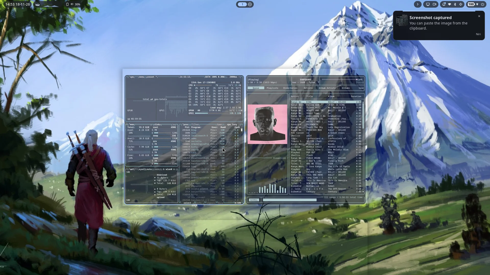

# Dotfiles

Niri + Noctalia desktop, zsh and CLI configs for CachyOS / Arch, managed with
[GNU Stow](https://www.gnu.org/software/stow/). Files in `$HOME` are symlinks
into this repo, so editing `~/.config/kitty/kitty.conf` edits
`kitty/.config/kitty/kitty.conf` here.

## Screenshots

| Desktop | Overview |
|---|---|
|  |  |

btop, rmpc and cava running as a floating TUI stack:


## Install

Tested on **CachyOS**. Other Arch-based systems work with the caveats below.

### 1. Install git, stow and build tools

```bash
sudo pacman -S --needed git base-devel stow
```

### 2. Install paru (AUR helper)

On CachyOS:

```bash
sudo pacman -S --needed paru
```

On plain Arch:

```bash
git clone https://aur.archlinux.org/paru.git /tmp/paru
cd /tmp/paru && makepkg -si
```

### 3. Clone the repo

```bash
git clone https://github.com/A8125/Dotfiles.git ~/Projects/dots
cd ~/Projects/dots
```

### 4. Trim the package lists (recommended)

`pkglist.txt` is a snapshot of one laptop (ASUS ROG, Intel + NVIDIA). Delete the
lines that don't apply to your machine before installing.

<details>
<summary>Hardware-specific packages</summary>

- **NVIDIA:** `nvidia-utils` `nvidia-settings` `nvidia-prime` `opencl-nvidia`
  `lib32-nvidia-utils` `lib32-opencl-nvidia` `libva-nvidia-driver`
  `linux-cachyos-nvidia-open` `linux-cachyos-lts-nvidia-open`
- **ASUS ROG:** `asusctl` `rog-control-center`
- **Intel:** `intel-lpmd` `intel-ucode` `intel-media-driver` `vulkan-intel`
  `lib32-vulkan-intel` `vpl-gpu-rt`
- **Extra kernels:** `linux-cachyos` `linux-cachyos-headers`
  `linux-cachyos-lts` `linux-cachyos-lts-headers` (keep only the one you boot)
- **CachyOS-only:** the `cachyos-*` packages, `chwd` and `limine-snapper-sync`.
  On plain Arch, delete them or add the CachyOS repos to `/etc/pacman.conf`.

To drop the NVIDIA and ASUS lines in one go:

```bash
sed -i -E '/nvidia|asusctl|rog-control-center/d' pkglist.txt
```

</details>

### 5. Run the installer

```bash
./install.sh
```

| Flag | Effect |
|---|---|
| *(none)* | Install packages, stow configs, ask about wallpapers (default: no) |
| `--wallpapers` | Copy the 32 MB wallpaper set to `~/Pictures/Wallpapers`, no prompt |
| `--no-wallpapers` | Skip wallpapers, no prompt |
| `--system` | Also install `locale.conf`, `vconsole.conf` and `sddm.conf` into `/etc` |
| `--help` | Show usage |

Flags can be combined, e.g. `./install.sh --system --no-wallpapers`.

The script installs `pkglist.txt` and `pkglist-aur.txt` with `paru`, moves any
conflicting files in `$HOME` to `<file>.pre-stow` (nothing is deleted), then runs
`stow --no-folding -t ~` on every package. A failing package build does **not**
stop the dotfiles from being linked. A few AUR packages are likely to break
(`checkra1n-*`, `woeusb`, `gray-git`, `qtengine`, `peaclock`, `awww-git`,
`python-fabric-git`, `fabric-cli-git`). Remove any that fail from
`pkglist-aur.txt` and re-run; the script is safe to run again.

### 6. Log out and back in

Logging in on **tty1** starts niri automatically (through `uwsm`, set up in
`.zshrc`).

## After installing

- **Monitors:** run `niri msg outputs` and edit `~/.config/niri/cfg/display.kdl`
  (it currently has `eDP-1` and `DP-3`).
- **Wallpaper:** pick one in Noctalia so matugen generates the theme colors. If
  your home isn't `/home/flickowens`, fix `wallpaper.directory` in
  `~/.config/noctalia/settings.json`.
- **Accounts:** `gh auth login`, and recreate your SSH and GPG keys. They are
  never tracked.
- **Services:** the lists are in `services-system.txt` and `services-user.txt`.
  For example:

  ```bash
  sudo systemctl enable --now bluetooth.service
  systemctl --user enable --now mpd.service
  ```

- **Not in the repo:** fonts (`~/.fonts`, 318 MB, so icons may show as boxes
  until you install a Nerd Font), the SDDM `silent` theme, Limine, Snapper, `ufw`
  rules, and any `secrets.zsh`.

## What's inside

| Package | Contents |
|---|---|
| `niri` `noctalia` | Compositor config and shell (settings, colors, plugins) |
| `zsh` | `.zshrc`, aliases, functions |
| `kitty` `alacritty` `foot` `ghostty` `fuzzel` | Terminals and launcher |
| `btop` `yazi` `cava` `rmpc` `mpd` | TUI apps |
| `micro` `zed` `nvim` `fastfetch` | Editors and fetch |
| `matugen` `gtk` `qt` `kde` `autostart` `pipewire` `thunar` `rog` | Theming and desktop integration |
| `opencode` `bin` `notes` | opencode config, helper scripts, personal notes |

`system/reference/` holds snapshots of this machine's `/etc` files (`fstab`,
`mkinitcpio.conf`, Limine and so on). They are for reading only; **never copy
them to another machine**, because they contain this disk's UUIDs and boot setup.

## Rollback

```bash
cd ~/Projects/dots
stow -D -t ~ zsh niri noctalia kitty alacritty foot ghostty fuzzel btop yazi \
  cava rmpc mpd micro zed nvim fastfetch matugen gtk qt kde autostart \
  pipewire thunar rog opencode bin notes
find ~ -maxdepth 6 -name '*.pre-stow'
```

The `*.pre-stow` files are your original configs; rename them back if needed.
