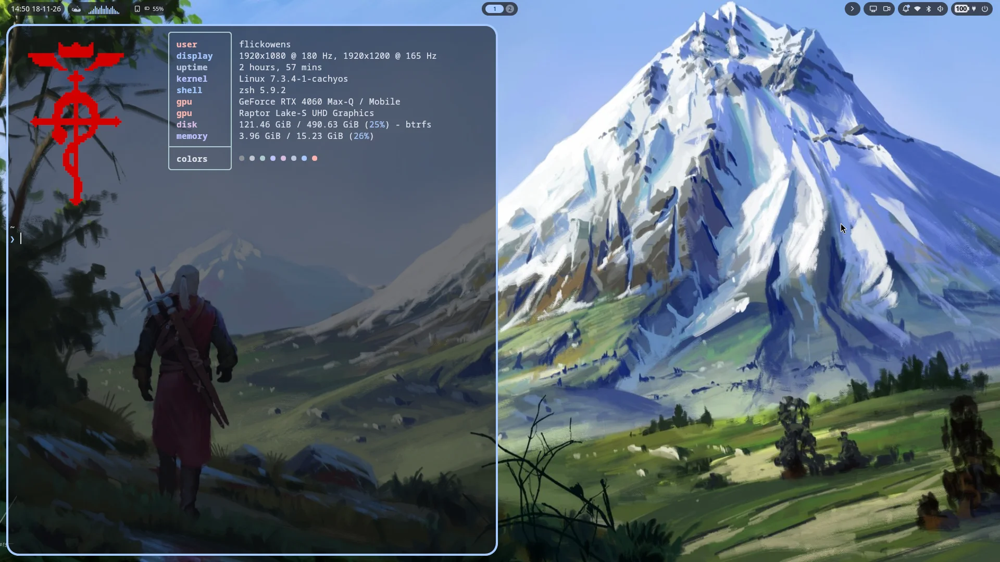
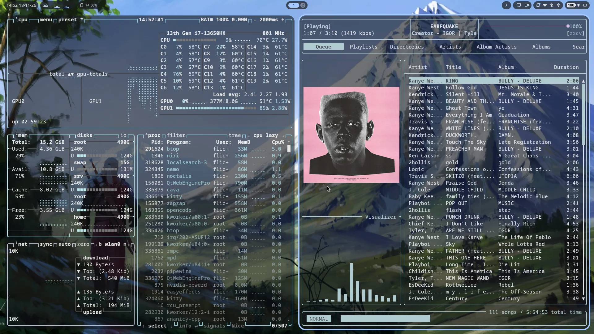

# Dotfiles

Niri + Noctalia desktop, zsh and CLI configs for CachyOS / Arch, managed with
[GNU Stow](https://www.gnu.org/software/stow/). Files in `$HOME` are symlinks
into this repo, so editing `~/.config/kitty/kitty.conf` edits
`kitty/.config/kitty/kitty.conf` here.

## Screenshots

| Desktop | Overview |
|---|---|
|  |  |

btop, rmpc and cava running as a floating TUI stack:



## Install

Tested on **CachyOS**. Other Arch-based systems work with the caveats below.

### 1. Clone the repo

```bash
git clone https://github.com/A8125/Dotfiles.git ~/Projects/dots
cd ~/Projects/dots
```

> [!NOTE]
> You don't need to install git, stow, paru, zsh, fastfetch or chafa first —
> `install.sh` bootstraps all of them automatically.

### 2. Run the installer

```bash
./install.sh             # interactive profile menu
./install.sh --minimal   # minimal profile, no menu
./install.sh --full      # full profile, no menu
```

The script first asks which profile to install:

```
Choose what to install:
  1) Minimal - niri + noctalia + kitty + fastfetch   [default]
  2) Full    - all packages and dotfiles from my setup
Choice [1/2]:
```

Press **Enter** (or `1`) for Minimal. Type `2` for Full.
Without a terminal on stdin the script defaults to Minimal automatically.

#### Install profiles

| Profile | Packages | Stow packages | Use when |
|---|---|---|---|
| **Minimal** *(default)* | `pkglist-minimal.txt` | `zsh niri noctalia kitty fastfetch matugen pipewire` | Fresh machine, quick start |
| **Full** | `pkglist.txt` + `pkglist-aur.txt` | All 28 stow packages | Complete setup matching this machine |

**Minimal** contains: niri, noctalia, kitty, fastfetch, chafa, matugen-bin,
uwsm, pipewire stack, wl-clipboard, cliphist, polkit-gnome.

Re-running `./install.sh` (or `./install.sh --full`) after a minimal install is
safe — `--needed` skips already-installed packages and `stow` is idempotent.

Whatever profile runs, the script will:

1. Run `sudo pacman -S --needed git base-devel stow zsh fastfetch chafa`.
   It does **not** upgrade the system by default; pass `--upgrade` to run
   `pacman -Syu` first (you can Ctrl-C at the prompt to abort).
2. Install `paru` if it isn't already present (tries the CachyOS repo first,
   then builds from the AUR).
3. Install the profile's package list with `paru`. Hardware-specific packages
   are skipped automatically (see [Hardware filtering](#hardware-filtering)
   below). A failing AUR build does **not** stop the rest.
4. Move any conflicting files or foreign symlinks in `$HOME` to
   `<file>.pre-stow` (nothing is deleted, and existing backups are never
   overwritten), then run `stow --no-folding -t ~` on the profile's stow
   packages. If stow still hits a conflict it stops and says so.
5. Link any `*.toml` files found in the noctalia repo package into
   `~/.config/noctalia/`. This is a no-op today: the repo contains no TOML
   files.
6. Copy the 32 MB wallpaper set to `~/Pictures/Wallpapers` only if you ask for
   it (`--wallpapers` or a `y` answer).

| Flag | Effect |
|---|---|
| *(none)* | Interactive profile menu (default: Minimal) |
| `--minimal` | Install the minimal profile without the menu |
| `--full` | Install the full profile without the menu |
| `--wallpapers` | Copy the 32 MB wallpaper set to `~/Pictures/Wallpapers`, no prompt |
| `--no-wallpapers` | Skip wallpapers, no prompt |
| `--system` | Also install `locale.conf`, `vconsole.conf` and `sddm.conf` into `/etc` |
| `--all-packages` | Disable hardware filtering; install every package in the lists |
| `--upgrade` | Run `pacman -Syu` (full system upgrade) before installing |
| `--help` | Show usage |

Flags can be combined, e.g. `./install.sh --system --no-wallpapers`.

#### Minimal profile: what won't work

The keybinds below are configured in niri but their programs are not installed
by the minimal profile. Everything else (compositor, shell, bar, launcher, lock,
volume/brightness, media keys, clipboard, screenshots) works.

| Keybind | Program | Install with |
|---|---|---|
| `Mod+B` | firefox | Full profile |
| `Mod+W` | librewolf | not installed — see below |
| `Mod+O` | obsidian | Full profile |
| `Mod+M` | spotify-launcher | Full profile |
| `Mod+E` | nemo (file manager) | Full profile |
| `Ctrl+Shift+Space` | niri-animations picker (noctalia plugin) | Full profile |

`librewolf` is not in `pkglist.txt` (it is missing from this machine's package
snapshot), so `Mod+W` stays unbound after **either** profile. Install it
manually with `paru -S librewolf` if you want the keybind to work.

A few AUR packages are likely to break (`checkra1n-*`, `woeusb`, `gray-git`,
`qtengine`, `peaclock`, `awww-git`, `python-fabric-git`, `fabric-cli-git`).
Remove any that fail from `pkglist-aur.txt` and re-run; the script is safe to
run again.

### Hardware filtering

By default the installer detects which hardware is present and skips packages
that don't apply:

| Packages skipped | Condition for skipping |
|---|---|
| anything containing `nvidia` | No NVIDIA display adapter found in `/sys/bus/pci/devices/` |
| `asusctl` `rog-control-center` `supergfxctl` | `/sys/class/dmi/id/sys_vendor` doesn't contain "ASUS" |
| `intel-media-driver` `libva-intel-driver` `vulkan-intel` `lib32-vulkan-intel` `vpl-gpu-rt` | No Intel display adapter found |
| `intel-ucode` `intel-lpmd` | CPU is not GenuineIntel, or running inside a VM |
| `linux-cachyos*` (all kernels, headers, nvidia modules) | Always skipped — the CachyOS installer already set up your kernel |

Pass `--all-packages` to disable all filtering and install everything in the
lists.

The script prints a summary at the end showing which packages were skipped,
which were not found in any repo, and which AUR builds failed.

### 3. Log out and back in

Logging in on **tty1** starts niri automatically (through `uwsm`, set up in
`.zshrc`).

## After installing

- **Monitors:** run `niri msg outputs` and edit `~/.config/niri/cfg/display.kdl`
  (it currently has `eDP-1` and `DP-3`).
- **Wallpaper:** pick one in Noctalia so matugen generates the theme colors.
  If you skipped the wallpaper copy, put your own images in
  `~/Pictures/Wallpapers` (or change `wallpaper.directory` in
  `~/.config/noctalia/settings.json`) — matugen and Noctalia need a wallpaper
  directory to work.
- **fastfetch logo:** `fastfetch/.config/fastfetch/pngs/` is tracked and
  stowed like every other file, so the images appear in
  `~/.config/fastfetch/pngs/` automatically.
- **Noctalia TOML:** the repo currently has no `*.toml` files. If you add one
  to `noctalia/.config/noctalia/` (or directly to `noctalia/`), the installer
  ensures it is symlinked into `~/.config/noctalia/`.
- **Accounts:** `gh auth login`, and recreate your SSH and GPG keys. They are
  never tracked.
- **Services:** the lists are in `services-system.txt` and `services-user.txt`.
  For example:

  ```bash
  sudo systemctl enable --now bluetooth.service
  systemctl --user enable --now mpd.service
  ```

- **Not in the repo:** fonts (`~/.fonts`, 318 MB, so icons may show as boxes
  until you install a Nerd Font), the SDDM `silent` theme, Limine, Snapper, `ufw`
  rules, and any `secrets.zsh`.

## What's inside

| Package | Contents |
|---|---|
| `niri` `noctalia` | Compositor config and shell (settings, colors, plugins) |
| `zsh` | `.zshrc`, aliases, functions |
| `kitty` `alacritty` `foot` `ghostty` `fuzzel` | Terminals and launcher |
| `btop` `yazi` `cava` `rmpc` `mpd` | TUI apps |
| `micro` `zed` `nvim` `fastfetch` | Editors and fetch |
| `matugen` `gtk` `qt` `kde` `autostart` `pipewire` `thunar` `rog` | Theming and desktop integration |
| `opencode` `bin` `notes` | opencode config, helper scripts, personal notes |

`system/reference/` holds snapshots of this machine's `/etc` files (`fstab`,
`mkinitcpio.conf`, Limine and so on). They are for reading only; **never copy
them to another machine**, because they contain this disk's UUIDs and boot setup.

## Rollback

```bash
cd ~/Projects/dots
stow -D -t ~ zsh niri noctalia kitty alacritty foot ghostty fuzzel btop yazi \
  cava rmpc mpd micro zed nvim fastfetch matugen gtk qt kde autostart \
  pipewire thunar rog opencode bin notes
find ~ -maxdepth 6 -name '*.pre-stow'
```

The `*.pre-stow` files are your original configs; rename them back if needed.
